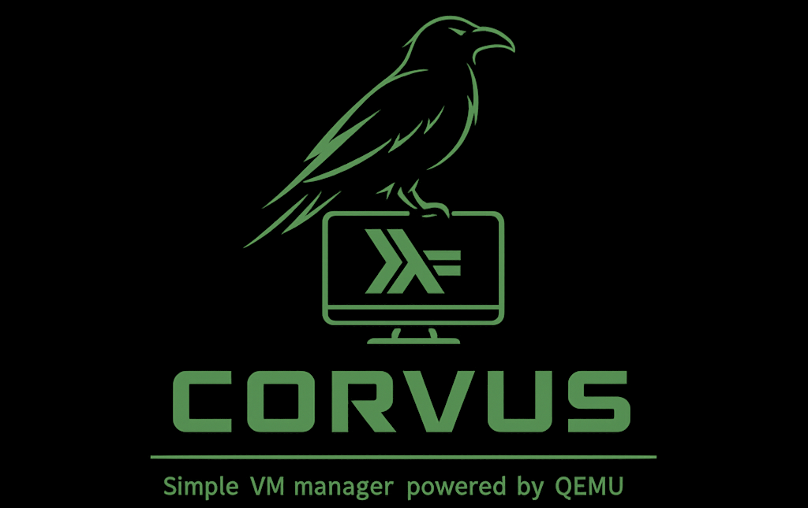

# Corvus

Corvus manages QEMU/KVM virtual machines on Linux, from a single workstation to
multiple hosts. It provides VM lifecycle and disk management, snapshots,
cloud-init, guest-agent operations, managed networking, and declarative YAML
configuration and image builds.

The Haskell daemon coordinates the database, scheduling, and tasks. Per-host
node agents run VMs and manage storage; a privileged network agent manages host
networking. Use the `crv` command line, Python client, browser interface, or
native desktop application to interact with the daemon.

See the [installation and quick start guide](doc/README.md) to get started,
the [documentation index](doc/INDEX.md) for all guides, and the
[development guide](doc/development.md) to contribute.

Licensed under BSD-3-Clause.

