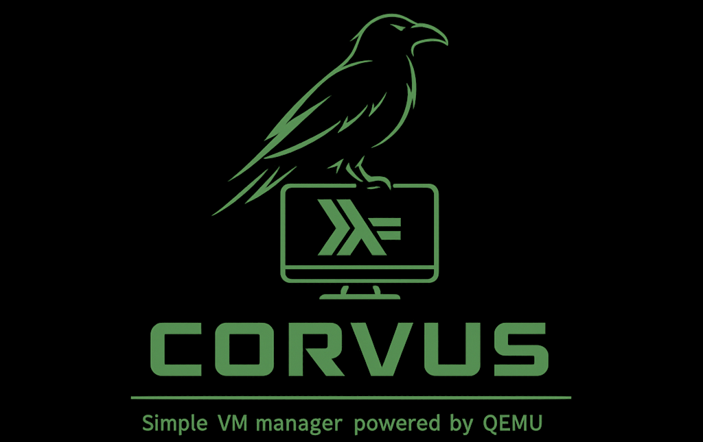

# Corvus

A lightweight QEMU/KVM virtual machine management daemon written in Haskell.

Corvus provides a daemon (`corvus`) that manages VM lifecycle and a CLI client (`crv`) for interacting with it. VM state is stored in SQLite by default, with PostgreSQL available for deployments that prefer a server database, and VMs run via QEMU with KVM acceleration.

## Features

- **VM Lifecycle Management**: Start, stop, pause, and reset virtual machines
- **State Machine**: Enforces valid state transitions (stopped -> running -> paused, etc.)
- **Disk Image Management**: Create, resize, clone, overlay, rebase, and attach qcow2/raw/vmdk/vdi disk images; import from local path or HTTP URL
- **Snapshot Support**: Create, rollback, merge, and delete qcow2 snapshots
- **Cloud-Init Integration**: Optional per-VM cloud-init with SSH key injection via NoCloud datasource; custom user-data and network-config per VM; lazy ISO generation on first SSH key attach or VM start
- **QEMU Guest Agent**: Execute commands in guests, periodic health checks and network address discovery via QGA protocol
- **SPICE Display**: Remote desktop access via SPICE protocol
- **Serial Console**: Buffered serial console for headless VMs with scrollback replay on reconnect
- **VM Templates**: Define VM blueprints in YAML and instantiate them easily
- **Declarative Apply**: Define entire environments (VMs, disks, networks, SSH keys) in a single YAML file with `crv apply`
- **Virtual Networks**: Bridge-based virtual networks with dnsmasq DHCP/DNS, owned by the privileged `corvus-netd` agent (host root netns)
- **Shared Directories**: virtiofs support for sharing host directories with guests
- **TPM 2.0**: Optional per-VM TPM CRB device backed by persistent `swtpm` state
- **Task History**: Every mutating operation is tracked with timestamps, results, and error messages
- **Web Interface**: Browser-based dashboard, VM/disk/network management, in-browser serial console, and live task feed via the `corvus-web` gateway ([web-interface.md](web-interface.md))

## Installation

### Prerequisites

Runtime tools belong on the host that uses them: QEMU and storage helpers on
each VM node, networking tools on netd hosts, and viewers on the client.

- QEMU with KVM support
- `qemu-img` (for disk image operations)
- `virtiofsd` (for shared directories)
- `swtpm` and `tar` (for VMs with TPM 2.0 enabled or TPM VM migration)
- `genisoimage` or `mkisofs` (for cloud-init ISO generation)
- `dnsmasq` and host networking tools for managed networks (see [Networking](networking.md))
- `vde_switch` only when using an externally managed VDE network
- `curl` or `wget` (optional, for HTTP disk image import)
- Remmina with SPICE and encryption support, or `remote-viewer` from virt-viewer (for graphical `vm view`; virt-viewer is preferred when both are installed)

### Binary Releases

Pre-built Linux x86_64 binaries are available on GitHub:

https://github.com/vonabarak/corvus/releases

Extract the release tarball and enter its `corvus-<version>-linux-amd64` directory.
Install all four binaries from `bin/` on a single-host installation:

```bash
mkdir -p ~/.local/bin
install -m 755 bin/corvus bin/crv bin/corvus-nodeagent bin/corvus-netd ~/.local/bin/
pipx install python/corvus-*.whl
```

Ensure `~/.local/bin` is in your `PATH`. The wheel provides `corvus-admin`,
`corvus-web`, and the Python client, and includes the built web assets. Python
3.10 or newer and `pipx` are needed for the command above; use a Python virtual
environment and `pip install python/corvus-*.whl` instead if preferred. The
optional [desktop interface](desktop-interface.md) needs the `desktop` extra.
Runtime tools listed above are installed separately. Continue with single-host
setup below; copying the daemon alone does not provision agents or certificates.

### Gentoo

An ebuild is available in the [vonabarak/gentoo](https://github.com/vonabarak/gentoo) overlay:

```bash
# Add the overlay (using eselect-repository)
eselect repository add vonabarak git https://github.com/vonabarak/gentoo.git
emaint sync -r vonabarak

# Install
emerge app-emulation/corvus
```

The `app-emulation/corvus` package builds from source. Enable the `binary` USE flag
to install pre-built binaries from GitHub releases instead:

```bash
echo 'app-emulation/corvus binary' >> /etc/portage/package.use/corvus
emerge app-emulation/corvus
```

The `9999` version installs the latest version from Git and does not support the `binary` USE flag.

### Building from Source

Building needs GHC and Stack; see the [development guide](development.md) for
the supported compiler and complete build dependencies. Python installs the
client and tools; Node.js/npm is needed to build the browser assets.

```bash
make build
make install  # Installs four binaries, completions, and the Python package
```

`make install` uses pipx when available, otherwise pip's user install. It builds
the browser assets when npm is available. To add them later, run
`make web-build` and reinstall the Python package. Desktop dependencies are
optional; see the [desktop guide](desktop-interface.md).

### Database Setup

The default database is SQLite. When the daemon starts without `--database`, it
uses `$XDG_DATA_HOME/corvus/corvus.db` or
`~/.local/share/corvus/corvus.db`, creates the parent directory if needed, and
creates the latest schema for an empty database or runs the retained versioned
migrations for an existing database. Startup fails if a required migration is
no longer included or the database is newer than the binary. See the
[database migration developer guide](database-migrations.md) for details.

To use PostgreSQL instead, create the database and pass a PostgreSQL URL:

```bash
createdb corvus
corvus --database postgresql://localhost/corvus
```

### Single-host setup (one command)

For a turn-key single-node install, run `corvus-admin quickstart` after `make install`. It generates the CA, mints every component cert, writes systemd unit files (user-mode for daemon and nodeagent, system-mode for netd), brings up the services, and registers the node with the daemon. sudo or doas is auto-detected; if neither is available, corvus-netd is skipped with a warning and the daemon + nodeagent come up without network management.

```bash
corvus-admin quickstart
```

### Multi-host or system-service setup (granular)

For multi-host deployments or when you want daemon/nodeagent as system services, see [doc/security.md](security.md) for the per-component flow. For dev / single-host use only, you can skip TLS entirely and pass `--no-tls` to every Corvus binary; Unix-socket connections never wrap with TLS. `crv` defaults to TCP; select the local socket explicitly with `--unix`. The web and desktop clients default to the Unix socket.

## Quick Start

### Starting the Daemon

Use `corvus-admin quickstart` for the first setup. A plain `corvus` invocation
requires certificates to have been provisioned already and does not start or
register the nodeagent. For manual deployment, follow [Security](security.md).

After `corvus-admin quickstart` has run, the daemon's systemd unit is already enabled and started — you can manage it with the usual `systemctl --user` commands:

```bash
# Edit the database path or connection string if needed
systemctl --user edit corvus

# Enable and start
systemctl --user enable --now corvus

# Check status / logs
systemctl --user status corvus
journalctl --user -u corvus -f
```

The service listens on **both** `$XDG_RUNTIME_DIR/corvus/corvus.sock` and TCP `0.0.0.0:9876` by default, and restarts automatically on failure. Pass `--no-unix` or `--no-tcp` to disable either listener; `--socket PATH` overrides the Unix socket path, `--host HOST` / `--port PORT` override the TCP bind.

### Creating Your First VM

After quickstart, check that the daemon responds and at least one node is
online. The account running the nodeagent needs access to `/dev/kvm` and enough
free RAM and disk space. User-mode networking below does not require netd.

```bash
crv ping
crv node list
```

Download a Linux cloud image with NoCloud support from your distribution.
Corvus' default cloud-init creates a `corvus` user with the assigned SSH keys.
Enable a serial console in the guest if you
want a headless console. In this example, replace `/absolute/path/cloud.qcow2`
with the downloaded file **on the client**. Have `~/.ssh/id_ed25519.pub` ready,
or substitute another public key path.

```bash
# Upload a client-local cloud image
crv disk upload alpine /absolute/path/cloud.qcow2 --format qcow2

# Create an overlay (thin copy-on-write)
crv disk overlay my-root alpine

# Create the VM
crv vm create my-vm --cpus 2 --ram 2G --cloud-init --headless

# Attach the disk and a network interface
crv disk attach my-vm my-root --interface virtio
crv net-if add my-vm --type user

# Add an SSH key
crv ssh-key create admin "$(cat ~/.ssh/id_ed25519.pub)"
crv ssh-key attach my-vm admin

# Start the VM
crv vm start my-vm --wait
crv vm show my-vm
crv vm view my-vm
```

`vm view` opens the headless serial console; press `Ctrl+]` then `q` to leave it without
stopping the VM. A blank console can mean the image has no serial getty. VM
startup completion does not guarantee cloud-init has finished. User-mode NAT
allows outbound traffic; inbound SSH needs [port forwarding](networking.md#port-forwarding-user-mode).

Enable `--guest-agent` when creating a VM only if the image has a running QEMU
guest agent. It changes startup readiness to wait for the agent, and enables
[guest execution](guest-exec.md) and [guest file transfer](guest-files.md).
See [Troubleshooting](troubleshooting.md) if the node is offline or startup fails.

### Connection Options

```bash
# TCP to 127.0.0.1:9876 (default)
crv vm list

# Custom TCP host / port — equivalently set CORVUS_HOST / CORVUS_PORT
crv --host daemon.example.com --port 9876 vm list
CORVUS_HOST=daemon.example.com crv vm list

# Unix socket (default path)
crv --unix vm list

# Custom Unix socket path — implies --unix; equivalently set CORVUS_SOCKET
crv --socket /tmp/corvus.sock vm list
```

### Network Transparency

Management commands and serial/HMP streams use the daemon's RPC connection.
For graphical VMs, `vm view` obtains a short-lived SPICE host/port/password grant
and launches a native viewer on the client. That viewer also needs network
access to the VM node's advertised SPICE address and port. The web gateway
needs the same reachability for its browser SPICE proxy.

Disk registration and import paths are interpreted on the selected target
node; use `crv disk upload` for a file on the client. Shared-directory paths
also refer to the VM node's filesystem.

TCP uses mutual TLS. `corvus-admin init` creates the CA on the admin workstation;
`corvus-admin deploy` provisions component certificates. The daemon requires a
client certificate with a `corvus-client:` CN prefix. See [Security](security.md)
for setup and certificate locations. Unix sockets rely on filesystem permissions.

### Output Formats

Commands returning structured records support `--output json` and `--output yaml`
for machine-readable output. Interactive consoles and streamed guest output
retain their own output formats:

```bash
crv vm list -o json
crv disk show my-root -o yaml
```

Text list output supports choosing columns with `-O` / `--columns`:

```bash
crv vm list -O ID,NAME,STATUS
crv vm list -O all
```

Selectors match descriptive headers and have shell autocompletion. The default
column set stays the same. Column selection is only valid for text list output;
`-O` with `-o json` or `-o yaml` is an error. See [List Output Columns](list-output.md)
for the full catalog and selection rules.

### Shell Completion

```bash
# Zsh
mkdir -p ~/.local/share/zsh/site-functions
crv completion zsh > ~/.local/share/zsh/site-functions/_crv

# Bash
mkdir -p ~/.local/share/bash-completion/completions
crv completion bash > ~/.local/share/bash-completion/completions/crv

# Fish
mkdir -p ~/.config/fish/completions
crv completion fish > ~/.config/fish/completions/crv.fish
```

## Documentation

See the [categorized index](INDEX.md) for the same catalog grouped by audience.

These catalogs cover all first-party Markdown guides and recipe READMEs,
including guides outside `doc/`. Agent policy and upstream vendored documentation
are excluded. Developer source-code links require a source checkout.

| Category | Guide | Covers |
|---|---|---|
| Getting started | [Project overview](../README.md) | Project purpose, components, and entry points |
| Getting started | [Installation and quick start](README.md) | Runtime prerequisites, installation, single-host setup, and first VM |
| Getting started | [Desktop interface](desktop-interface.md) | Install, connect, manage resources, and open native viewers |
| Getting started | [Web interface](web-interface.md) | Gateway setup, browser consoles, recovery, and frontend development |
| Getting started | [Troubleshooting](troubleshooting.md) | Connection, certificate, node, VM, network, and console diagnostics |
| VMs and resources | [VM management](vm-management.md) | Create, edit, start, stop, save, monitor, and view VMs |
| VMs and resources | [Disk management](disk-management.md) | Image versions and tags, placement, import/upload, attach, and cleanup |
| VMs and resources | [Snapshots](snapshots.md) | Disk and full-machine checkpoints, rollback, and deletion |
| VMs and resources | [Networking](networking.md) | Managed networks, interfaces, DNS, VDE, and port forwarding |
| VMs and resources | [Multi-node deployments](multi-node.md) | Node registration, placement, agent connections, and maintenance |
| VMs and resources | [VM migration](vm-migration.md) | Save-and-restore VM migration and agent-to-agent disk transfers |
| VMs and resources | [Security](security.md) | Mutual TLS, certificate provisioning, renewal, and trust boundaries |
| VMs and resources | [SSH keys](ssh-keys.md) | Assign keys for cloud-init and inject them explicitly through QGA |
| VMs and resources | [Cloud-init](cloud-init.md) | NoCloud configuration, SSH key injection, ISO generation, and Windows |
| VMs and resources | [Shared directories](shared-directories.md) | Node-local virtiofs shares and viewer-local SPICE folder sharing |
| VMs and resources | [VM audio](vm-audio.md) | Sound cards, audio backends, playback, and microphone support |
| VMs and resources | [Guest execution](guest-exec.md) | Execute commands through the QEMU guest agent |
| VMs and resources | [Guest file transfers](guest-files.md) | Upload and download files through the QEMU guest agent |
| VMs and resources | [Task history](task-history.md) | Inspect operations, wait for completion, and request cancellation |
| VMs and resources | [List output columns](list-output.md) | Select text columns and use column completion |
| VMs and resources | [Observability](observability.md) | Resource samples, Prometheus metrics, and Grafana queries |
| Declarative configuration | [Templates](templates.md) | Reusable VM blueprints and instantiation |
| Declarative configuration | [Apply configuration](apply-configuration.md) | Declare environments, image policies, and resource dependencies |
| Declarative configuration | [Image builds](image-builds.md) | Procedural image pipelines, cache, provisioners, and editor schema |
| Development and internals | [Architecture](architecture.md) | Component ownership, source layout, entities, and runtime patterns |
| Development and internals | [Development guide](development.md) | Build dependencies, tests, implementation conventions, and doc maintenance |
| Development and internals | [Database migrations](database-migrations.md) | Versioned SQLite/PostgreSQL upgrades, fixtures, and migration tests |
| Development and internals | [VM lifecycle and fencing](vm-lifecycle.md) | State transitions, lifecycle revisions, and stale-start protection |
| Development and internals | [RPC protocol](rpc-protocol.md) | Capabilities, shared records, errors, streams, and schema generation |
| Development and internals | [Python client](../python/README.md) | Typed synchronous/asynchronous APIs, subscriptions, and examples |
| Development and internals | [Integration test harness](../integration_tests/README.md) | Nested-VM prerequisites, test authoring, scheduling, and debugging |
| Development and internals | [Developer node](dev-node.md) | Long-lived nested development environment and iteration workflow |
| Development and internals | [Managed image recipes](test-images.md) | Build, check, clean, and rebuild image fixtures; import ownership |
| Development and internals | [QEMU command example](../qemu-command-example.md) | Annotated nodeagent-generated command and device topology |
| Development and internals | [SPICE client maintenance](../frontend/src/lib/spice/README.md) | Vendored browser SPICE source and local extension rules |
| Recipe guides | [AlmaLinux desktop](../yaml/almalinux-10-desktop/README.md) | Unattended AlmaLinux 10 GNOME installation with Kickstart |
| Recipe guides | [Monitoring appliance](../yaml/corvus-monitor/README.md) | Prometheus/Grafana image, configuration, and deployment |
| Recipe guides | [FreeBSD guest](../yaml/freebsd/README.md) | Headless FreeBSD image with serial console, QGA, and NoCloud |
| Recipe guides | [Gentoo guests](../yaml/gentoo/README.md) | Cloud imports, headless guests, and development images |
| Recipe guides | [Windows 11 base](../yaml/windows-11/README.md) | Generalized Windows 11 Pro base, template, and per-VM TPM |
| Recipe guides | [Windows 11 desktop](../yaml/windows-11-desktop/README.md) | Desktop applications on the managed Windows 11 base |

## Daemon Commands

```bash
crv ping             # Ping the daemon
crv status           # Get daemon status (uptime, connections, version)
crv shutdown         # Request daemon shutdown
```

## Development

### Building and Testing

See the [development guide](development.md) for build dependencies, Make targets,
test structure, implementation conventions, and required verification.

### Test Images

Integration tests require host-side image fixtures. Build every managed image
with `make images`, or select, check, clean, and rebuild a fixture with
`make image IMAGE=<name>`, `make image-check IMAGE=<name>`,
`make image-clean IMAGE=<name>`, and `make image-rebuild IMAGE=<name>`.
Run `make image-list` for the available names. See
[image-build guide](test-images.md) for each artifact and its ownership.

### Running Locally

```bash
stack exec corvus -- --log-level debug
stack exec crv -- --unix vm list
```

## Architecture

See the [architecture guide](architecture.md) for component ownership and the
source layout. The sections below describe runtime behavior.

### Communication Protocol

Client and daemon communicate over TCP or Unix socket using
[Cap'n Proto](https://capnproto.org/) RPC. The wire schema lives in
[`schema/`](../schema/) and is the source of truth; see
[`doc/rpc-protocol.md`](rpc-protocol.md) for a full tour of the
capability tree (Daemon → managers → resources), the streaming
sinks (`ByteSink`, `BuildEventSink`, `GuestAgentStatusSink`,
`TaskProgressSink`), and a pycapnp client example.

Streaming flows use Cap'n Proto sinks rather than a protocol-upgrade
escape hatch: `crv vm view` on a headless VM, `crv vm monitor`,
and `crv build --wait` each hand the daemon a sink cap, the daemon
pushes events through it, and the client closes the relay by
dropping the sink (typically via `Ctrl+]` followed by `q` on
interactive consoles).

### Process Management

The daemon coordinates VM state and tasks. The nodeagent prepares cloud-init
media, starts QEMU and any required virtiofsd or swtpm helpers, and monitors
their processes. Graceful shutdown uses QMP `system_powerdown`; force stop
terminates the VM process. See [VM lifecycle](vm-lifecycle.md) for startup,
readiness, shutdown, and cleanup details.

### Runtime Files

On each VM node, sockets and runtime files are stored in `$XDG_RUNTIME_DIR/corvus/vms/<vm_id>/`:
- `monitor.sock` -- HMP monitor socket
- `qmp.sock` -- QMP control socket
- `serial.sock` -- Serial console socket (headless VMs)
- `qga.sock` -- QEMU Guest Agent socket
- `virtiofsd-<tag>.sock` -- virtiofsd sockets
- `swtpm.sock` -- swtpm control socket (TPM-enabled VMs)

Persistent TPM state is stored privately at `<basePath>/<vmName>/tpm2/`.
It survives VM and host restarts. Disabling TPM or deleting a TPM-enabled VM
removes this directory; the database change is aborted if removal fails.

SPICE is served over TCP (not Unix socket) with ticketed password authentication — see [vm-management.md](vm-management.md#spice-graphical-vms).

## Limitations

- **No Resource Limits**: No CPU/memory cgroup controls
- **No VNC**: Only SPICE display is supported
- **Linux Only**: Relies on KVM, Unix sockets, and POSIX signals


## License

BSD-3-Clause
